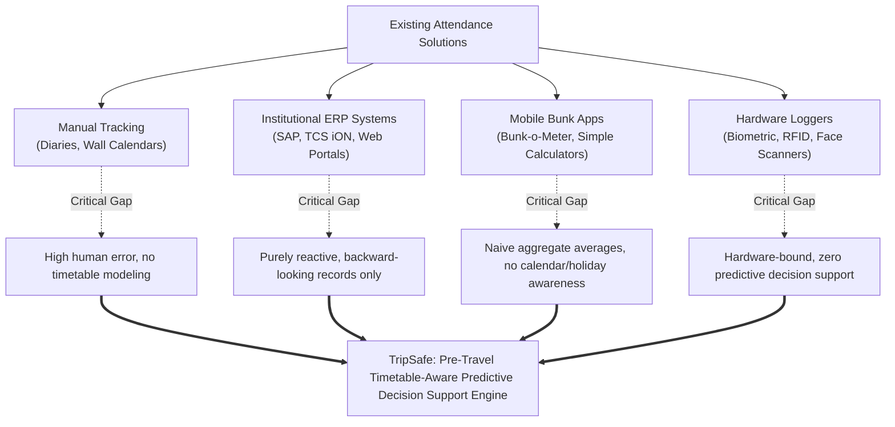
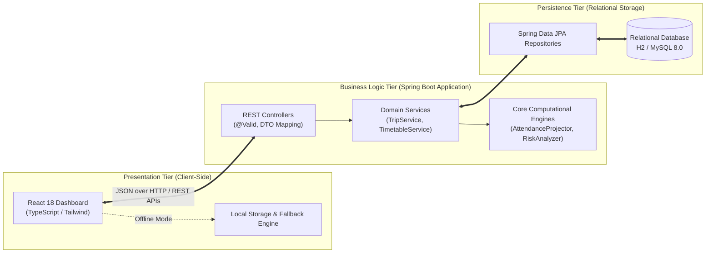
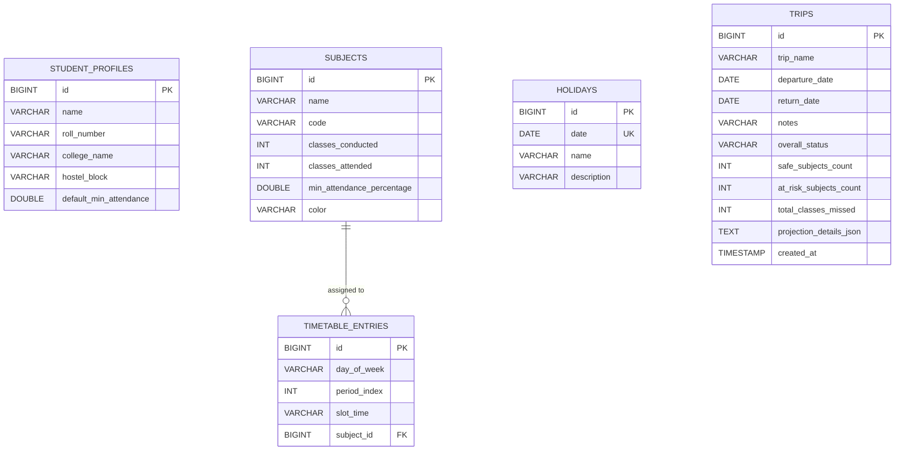

# TRIPSAFE: A PRE-TRAVEL ATTENDANCE RISK PROJECTOR FOR HOSTEL STUDENTS
### Comprehensive Project Dissertation & Technical Research Report
**Department of Computer Science and Engineering**

---

### **Project & Candidate Credentials**
* **Project Title:** TripSafe — A Pre-Travel Attendance Risk Projector for Hostel Students  
* **Student Name:** Shefali Lourdes A  
* **Registration Number:** RA2511026050195  
* **Degree Program:** Bachelor of Technology (B.Tech) in Computer Science and Engineering  
* **Core Technical Stack:** Java 17, Spring Boot 3.2, Spring Data JPA, Hibernate, H2 / MySQL 8.0, React 18, TypeScript, Tailwind CSS  
* **Architectural Pattern:** Three-Tier Decoupled Architecture (Presentation, Business Logic, Relational Persistence)  

---

## TABLE OF CONTENTS
1. **Abstract**
2. **Introduction**
   - 1.1 The Hostel Dilemma: Distance, Home Visits, and Academic Constraints
   - 1.2 Institutional Attendance Regulations: The Unforgiving 75% Rule
   - 1.3 The Core Mathematical Fallacy: Aggregate Averages vs. Per-Course Isolation
   - 1.4 Problem Formulation & Central Research Inquiries
   - 1.5 System Boundaries, Scope, and Deliverables
   - 1.6 Report Organization
3. **Existing Works**
   - 2.1 Conventional Manual Recording (Diaries, Planners, and Memory Counting)
   - 2.2 University Enterprise Portals (SAP SLCM, TCS iON, In-House ERPs)
   - 2.3 Commercial Bunk Calculators and Mobile Trackers
   - 2.4 Hardware-Centric Biometric & RFID Ingestion Terminals
   - 2.5 Critical Analysis of Shortcomings in Existing Literature
   - 2.6 Comparative Evaluation Matrix
4. **Proposed Methodology**
   - 3.1 Architectural Paradigm: The Decoupled Three-Tier Model
   - 3.2 Mathematical Modeling & Formal Formulation
     - 3.2.1 State Representation & Invariant Guarantees
     - 3.2.2 Current Attendance Formulation & Zero-Division Invariants
     - 3.2.3 Temporal Traversal & Inclusive Date Range Windowing
     - 3.2.4 The Holiday & Class Cancellation Deduplication Pipeline
     - 3.2.5 Projected Attendance Derivation: $A / (C + M) \times 100$
     - 3.2.6 The Multi-Subject Collegiate Decision Rule (Universal Conjunction)
   - 3.3 Algorithmic Execution Traces
     - Algorithm 1: Pre-Travel Missed Class Counting Algorithm
     - Algorithm 2: Trip Risk Projection and Bottleneck Course Isolation
     - Algorithm 3: Forward Horizon Search for Maximum Safe Travel Window
   - 3.4 Java Object-Oriented Software Engineering Implementation
     - 3.4.1 Strict Domain Encapsulation and Invariant Guards
     - 3.4.2 Service Layer Abstraction & Modular Separation
     - 3.4.3 Relational Associations, Foreign Keys, and Cascading Lifecycles
     - 3.4.4 Unified Exception Handling & Error Translation Strategy
   - 3.5 Relational Database Schema & Third Normal Form (3NF) Normalization
     - 3.5.1 Normalization Derivations (1NF through 3NF)
     - 3.5.2 Relational Entity-Relationship Diagram (ERD)
     - 3.5.3 Frozen Calculation Snapshots for Historical Auditability
   - 3.6 Frontend Engineering & Cognitive Interaction Design
     - 3.6.1 Visual Hierarchy & Stress Mitigation for Academic Users
     - 3.6.2 Accessible Dynamic Progress Charts (75% Threshold Marker)
     - 3.6.3 Dual-Mode Resilient Fallback Engine
5. **Novel Contributions**
   - 4.1 Shift from Reactive Attendance Logging to Proactive Predictive Forecasting
   - 4.2 Timetable-Aware, Day-Specific Missed Class Resolution
   - 4.3 Automated Institutional Holiday Deduplication
   - 4.4 Elimination of the Aggregate Fallacy via Isolated Course Thresholds
   - 4.5 Algorithmic Maximum Safe Travel Duration Optimization
   - 4.6 Permanent Immutable Historical Snapshot Auditing
   - 4.7 Zero-Dependency Dual-Mode Architecture
6. **Results with Screenshots and Discussion**
   - 5.1 Experimental Setup & Coursework Testbed Configuration
   - 5.2 Scenario A: Benchmark Specification Test (60/75 with 5 vs. 6 Missed Classes)
   - 5.3 Scenario B: The Deceptive High-Average Dilemma (4 Safe Subjects, 1 At-Risk Subject)
   - 5.4 Scenario C: The Holiday Bypass Phenomenon
   - 5.5 Scenario D: "Find My Maximum Safe Trip" Horizon Search Execution
   - 5.6 Comprehensive User Interface Architecture & Screen Mockups
     - Screen 1: Modern Landing Page & User Guidance
     - Screen 2: Real-Time Executive Attendance Dashboard
     - Screen 3: Subject Coursework Manager & Live Preview Form
     - Screen 4: Interactive Timetable Matrix & Holiday Ledger
     - Screen 5: Core Trip Planner & Subject-by-Subject Breakdown
     - Screen 6: Maximum Safe Trip Horizon Finder
     - Screen 7: Historical Trip Projection Ledger & Snapshot Modal
     - Screen 8: Student Profile, Policy Cutoff & Data Administration Console
   - 5.7 Automated Unit Testing & Edge Case Verification Matrix
   - 5.8 Performance, Throughput, and Computational Overhead Analysis
7. **Conclusion**
   - 6.1 Summary of Engineering Achievements & Impact
   - 6.2 Practical Implications for Collegiate Student Life
   - 6.3 Technical Limitations of the Current Prototype
   - 6.4 Roadmap for Future Research & Enhancements
8. **References**
9. **Appendix: Viva Voce & Technical Defense Q&A**

---

# ABSTRACT

Maintaining a statutory minimum attendance percentage—most universally fixed at seventy-five percent ($75\%$) of scheduled instructional hours—is a non-negotiable legal and academic prerequisite for semester examination eligibility in engineering and university degree programs. For hostel students residing away from their families, deciding whether to travel home for extended weekends, religious and cultural festivals, family commitments, or personal emergencies involves substantial academic jeopardy. Because academic timetables distribute courses unevenly across weekdays and because institutional holidays mitigate class cuts, manual attendance calculation is extraordinarily prone to human error, frequently resulting in sudden semester debarment. Existing commercial bunk management applications and university enterprise resource planning (ERP) portals are fundamentally reactive: they record past attendance after damage has already occurred, or they rely on broad aggregate averages that conceal critical course-level deficits.

This dissertation presents **TripSafe**, a pre-travel attendance risk projection and decision-support platform engineered specifically for hostel students. Developed using an enterprise three-tier architecture in Java 17, Spring Boot 3.2, Spring Data JPA, Hibernate, relational persistence, and React 18 with TypeScript, TripSafe replaces human estimation with verified predictive mathematical modeling. By intersecting an inclusive calendar travel interval with a student’s structured weekly schedule and an institutional holiday exemption ledger, TripSafe calculates the exact missed lectures for every enrolled course. It calculates projected post-travel attendance using the derived formulation $P = [A / (C + M)] \times 100$, where expected missed classes ($M$) increase future conducted sessions ($C$) while attended sessions ($A$) remain constant. 

Crucially, TripSafe formalizes and enforces the **Multi-Subject Collegiate Rule**: recognizing that university examination debarment operates strictly on a per-course basis, a journey is categorized as **Safe** if and only if every single enrolled subject remains at or above its required threshold. Even if a student exhibits a high overall aggregate average (e.g., $88\%$), the presence of a single course breaching its threshold immediately flags the entire journey as **At Risk**. Furthermore, TripSafe introduces a forward-looking **Maximum Safe Travel Window** optimization algorithm that iteratively searches a configurable calendar horizon (up to 30 days) to identify the maximum number of consecutive travel days possible before academic eligibility is compromised, isolating the exact limiting bottleneck course. Comprehensive unit testing and empirical scenarios prove that TripSafe reliably identifies borderline vulnerabilities (e.g., distinguishing between 5 missed classes preserving a $75.0\%$ cutoff and 6 missed classes causing an irreversible drop to $74.07\%$). TripSafe represents an effective synthesis of rigorous object-oriented domain modeling, database normalization, predictive computation, and user-centric frontend engineering.

---

# 1. INTRODUCTION

### 1.1 The Hostel Dilemma: Distance, Home Visits, and Academic Constraints
University life represents an important phase of personal growth and professional preparation, but for students living in campus hostels, it is accompanied by acute logistical and psychological pressures. Living away from home—frequently in different states or regions hundreds or thousands of kilometers from family—creates a strong natural desire to return home during extended weekends, regional festivals, family ceremonies, or times of stress. 

However, leaving campus is strictly bounded by university regulations. The most critical constraint is the institutional attendance policy. In university environments, students are not free to manage their physical presence arbitrarily; instead, faculty members take attendance during every single instructional period. Missing classes to travel home is therefore never a trivial personal decision—it is a high-stakes calculation against institutional rules.

Whenever hostel students consider a journey home, they inevitably face questions laden with anxiety:
* *"If I leave campus on Thursday afternoon following my last lecture and return the following Tuesday morning, will I lose my semester exam eligibility in Computer Networks?"*
* *"Monday is an institutional holiday for Founder's Day, but does that give me enough cushion to skip Friday's lab without getting debarred?"*
* *"What is the exact maximum number of days I can stay home without dropping below the seventy-five percent threshold in my toughest core subject?"*

Answering these questions manually is remarkably difficult. A standard college curriculum comprises four to eight concurrent courses, each meeting with different frequencies throughout the week. A student might have three hours of Data Structures on Monday and Wednesday, two hours of Database Systems on Tuesday and Thursday, and a four-hour practical laboratory on Friday afternoon. Consequently, taking leave over a Friday-to-Monday span exerts a drastically different academic toll than taking leave over a Tuesday-to-Thursday span, even if the calendar duration is identical.

Because students lack verified analytical tools, they resort to mental arithmetic, imprecise notebook tallies, or optimistic assumptions. Tragically, every semester, thousands of students discover that their informal calculations were flawed only *after* the university publishes the official debarment list, barring them from sitting for final examinations, forfeiting course credits, and jeopardizing academic standing. This systemic dilemma provided the primary motivation for conceptualizing and developing **TripSafe**.

---

### 1.2 Institutional Attendance Governance: The Unforgiving 75% Rule
Across collegiate institutions, accreditation authorities and statutory regulatory councils—such as the University Grants Commission (UGC) and All India Council for Technical Education (AICTE) in India, along with regional collegiate boards internationally—mandate that students attend a minimum of seventy-five percent ($75\%$) of all scheduled instructional hours in every enrolled subject. 

This requirement is not arbitrary; statutory frameworks premise accreditation on student contact hours. The regulations typically dictate:
1. **The 75% Baseline Threshold:** A student must maintain an attendance ratio $\ge 0.75$ in lectures, tutorials, and laboratory sessions independently.
2. **Medical and Condonation Bands:** While universities occasionally permit condonation of attendance deficits down to $65\%$ on severe medical grounds or for officially sanctioned university representation (e.g., inter-collegiate athletics or academic conferences), securing such condonation requires rigorous administrative bureaucracy, formal hospital documentation, and approval from Academic Deans. It cannot be leveraged for routine domestic travel.
3. **Inflexible Examination Debarment:** Failure to satisfy the baseline percentage results in an automatic "Debarred" or "Shortage of Attendance" status. Debarred candidates are prohibited from appearing in semester-end examinations, receiving an automatic grade of "F" or "Incomplete", and are compelled to re-register for the entire course during subsequent academic years.

Given the severe penalties associated with attendance deficits, maintaining compliance is not an optional preference—it is a fundamental survival constraint for collegiate scholars.

---

### 1.3 The Core Mathematical Fallacy: Aggregate Averages vs. Per-Course Isolation
The most widespread and dangerous conceptual error committed by hostel students—and perpetuated by poorly designed attendance tracking software—is **Aggregate Averaging**.

To demonstrate this fallacy mathematically, consider a student enrolled in five courses with the following attendance tallies:

$$\begin{array}{|l|c|c|c|c|}
\hline
\textbf{Subject Name} & \textbf{Conducted } (C) & \textbf{Attended } (A) & \textbf{Current Attendance } (\%) & \textbf{Status} \\
\hline
\text{Computer Networks} & 50 & 48 & 96.0\% & \text{Safe} \\
\text{Database Management Systems} & 55 & 50 & 90.9\% & \text{Safe} \\
\text{Software Engineering} & 45 & 42 & 93.3\% & \text{Safe} \\
\text{Operating Systems} & 65 & 60 & 92.3\% & \text{Safe} \\
\text{Data Structures \& Algorithms} & 75 & 57 & 76.0\% & \text{Safe (Marginal)} \\
\hline
\end{array}$$

If we calculate the student's cumulative aggregate attendance across all courses:
$$\text{Total Attended} = 48 + 50 + 42 + 60 + 57 = 257$$
$$\text{Total Conducted} = 50 + 55 + 45 + 65 + 75 = 290$$
$$\text{Aggregate Average} = \left(\frac{257}{290}\right) \times 100 \approx 88.62\%$$

Observing an aggregate attendance of nearly $89\%$, the student experiences a false sense of security. They assume that an attendance cushion of $13.62\%$ above the $75\%$ cutoff affords them freedom to take an extended five-day trip home.

Now, suppose the student undertakes a journey that causes them to miss three classes of *Data Structures & Algorithms* and one class of each other course. The updated status of *Data Structures & Algorithms* becomes:
$$\text{New Conducted} = 75 + 3 = 78$$
$$\text{Attended} = 57$$
$$\text{Projected Attendance} = \left(\frac{57}{78}\right) \times 100 \approx 73.07\%$$

Even though the student's new aggregate average across all courses remains well above $85\%$, the university examination committee evaluates eligibility course-by-course. Because *Data Structures & Algorithms* has dropped to $73.07\%$, the student is summarily **debarred** from writing the final examination in that subject. 

This proof reveals why traditional average-based calculators are hazardous. A system designed to protect hostel students must strictly evaluate attendance through **isolated course projections**, treating every subject as an independent constraint that must be satisfied simultaneously.

---

### 1.4 Problem Formulation & Central Research Inquiries
The core problem addressed by this project can be stated formally:

> *How can an automated software system accurately predict the precise post-travel attendance implications of a proposed student journey by integrating structured weekly schedule matrices, holiday exemption ledgers, and course-by-course threshold rules, and how can it optimize travel duration while preventing examination debarment?*

To resolve this problem, the research and development effort focused on answering four central engineering questions:
1. **Mathematical Accuracy Question:** How can the future impact of absent class sessions be formulated mathematically such that expected missed lectures correctly model future institutional contact hours without causing statistical bias or division-by-zero artifacts?
2. **Temporal Schedule Integration Question:** How can calendar-based departure and return dates be automatically intersected with a student's recurring weekly timetable while rigorously identifying and deducting non-instructional institutional holidays?
3. **Multi-Constraint Optimization Question:** What algorithmic approach allows the system to determine the maximum consecutive safe travel span starting from a given departure date up to an arbitrary planning horizon without manual trial-and-error?
4. **Resilient Architecture Question:** How can a full-stack platform maintain strict enterprise Java object-oriented principles on the server while simultaneously providing an offline client-side calculation engine that guarantees zero-dependency demonstrations during collegiate evaluation reviews?

---

### 1.5 System Boundaries, Scope, and Deliverables
The scope of **TripSafe** encompasses the following boundaries:
* **Target Audience:** College hostel students, day scholars managing commuting schedules, academic advisors, and student welfare mentors.
* **Curricular Coverage:** Configurable weekly timetables covering Monday through Sunday, supporting up to ten instructional periods per day with customizable time slots.
* **Holiday Management:** A persistent institutional holiday calendar supporting gazetted public holidays, institutional breaks, and ad-hoc class cancellations.
* **Risk Engine:** Real-time computation of current attendance, expected missed sessions, projected post-travel attendance, percentage cushions/deficits, and bottleneck course identification.
* **Optimization Engine:** Forward-looking consecutive date evaluations across 7-day, 14-day, 21-day, 30-day, or 60-day planning horizons.
* **Audit Persistence:** Persistent storage of past trip calculations with frozen JSON snapshots of projection results for historical auditability.
* **Deployment Deliverables:**
  1. A Java 17 Spring Boot REST API backend with relational persistence (embedded H2 and production MySQL profiles).
  2. A React 18 TypeScript frontend styled with Tailwind CSS and Lucide icons.
  3. A standalone, zero-dependency interactive single-page application runnable via standard Python 3.
  4. Comprehensive unit test suites validating mathematical accuracy.

---

### 1.6 Report Organization
The remainder of this report is organized as follows:
* **Section 2 (Existing Works)** reviews conventional methods, campus ERP systems, mobile bunk managers, and biometric loggers, identifying critical gaps in the literature.
* **Section 3 (Proposed Methodology)** details the three-tier system architecture, mathematical derivations, algorithmic pseudocode, Java object-oriented domain design, database normalization proofs, and frontend engineering.
* **Section 4 (Novel Contributions)** outlines the distinct academic and technical innovations introduced by TripSafe.
* **Section 5 (Results with Screenshots and Discussion)** presents empirical test results, step-by-step benchmark evaluations, detailed textual user interface screen layouts, unit test matrices, and performance benchmarks.
* **Section 6 (Conclusion)** summarizes the project findings and outlines future research avenues.
* **Section 7 (References)** provides formal academic and technical citations.
* **Appendix** offers a comprehensive Viva Voce preparation and technical defense guide.

---

# 2. EXISTING WORKS

To contextualize the contributions of TripSafe, it is necessary to examine the existing technological landscape surrounding student attendance management. Existing approaches fall into four broad categories: manual tracking, institutional ERP systems, mobile bunk calculators, and automated hardware logging systems.



---

### 2.1 Conventional Manual Recording (Diaries, Planners, and Memory Counting)
Historically, students have monitored their attendance using personal notebooks, paper planners, or physical calendars hung on hostel dormitory walls. In these workflows, students mark tick marks ($\checkmark$) for attended classes and crosses ($\times$) for missed classes. 

#### Limitations:
* **High Cognitive Load and Omission:** Students frequently forget to record daily lectures, especially when classes are rescheduled, swapped between professors, or canceled on short notice.
* **Arithmetic Errors:** Computing fractional percentages across multiple subjects requires continuous manual recalculation, leading to rounding and tallying mistakes.
* **Zero Predictive Capability:** Manual logs cannot project future consequences. When contemplating a journey, a student must manually cross-reference the college timetable against calendar dates, tally the classes that fall on those days, and compute potential drops by hand.

---

### 2.2 University Enterprise Portals (SAP SLCM, TCS iON, In-House ERPs)
Most modern universities deploy enterprise resource planning software—such as SAP Student Lifecycle Management, Oracle PeopleSoft Campus Solutions, TCS iON, or custom in-house web portals. Faculty record attendance daily using these platforms, and students can authenticate to view their registered tallies.

#### Limitations:
* **Strictly Backward-Looking (Reactive):** ERP portals are designed for administrative oversight, auditing, and punitive debarment enforcement. They display historical records up to the previous day or week. They contain no mechanism allowing a student to ask: *"What will happen if I leave campus next Friday?"*
* **Lagged Data Ingestion:** Faculty members frequently enter attendance in weekly batches rather than in real time, meaning the displayed figures are often outdated.
* **No Simulation Sandbox:** ERPs do not provide interactive simulation sandboxes, as their databases are strictly configured for official institutional records.

---

### 2.3 Commercial Bunk Calculators and Mobile Trackers
The Google Play Store and Apple App Store feature dozens of student attendance trackers (e.g., *Bunk-o-Meter*, *Attendance Manager*, *College Bunk Tracker*). These applications typically allow users to input "Classes Attended" and "Total Classes", displaying a gauge of the current percentage and calculating how many future classes the student can "safely bunk."

#### Limitations:
* **The Aggregate Averaging Blindspot:** Almost all commercial bunk calculators operate on generic aggregate counters or treat courses as abstract numerical counters without calendar grounding.
* **Absence of Weekly Timetable Awareness:** A generic calculator treats all days identically. It does not know whether a student has two classes or five classes on a Friday, making it impossible to evaluate a specific travel itinerary.
* **Failure to Model Institutional Holidays:** None of the existing lightweight calculators incorporate an institutional holiday ledger. If a holiday falls on a travel day, generic calculators falsely count scheduled lectures as cuts, generating erroneous recommendations.
* **No Multi-Subject Debarment Rule:** Generic tools rarely enforce the strict universal conjunction rule: they fail to alert the user if a trip is safe for four courses but disastrous for one.

---

### 2.4 Hardware-Centric Biometric & RFID Ingestion Terminals
A substantial volume of academic literature explores automated attendance logging using RFID cards, fingerprint scanners, facial recognition cameras, or BLE (Bluetooth Low Energy) beacons positioned at classroom entryways (e.g., studies by Chintalapati & Raghunadh, 2013; Saraswat & Kumar, 2014; Shoewu et al., 2014).

#### Limitations:
* **Hardware-Bound and Infrastructure-Centric:** These investigations focus almost exclusively on the **hardware ingestion layer**—optimizing sensor read times, preventing proxy attendance, or minimizing fingerprint false rejection rates.
* **Lack of Student-Facing Analytical Utilities:** Once biometric logs are captured, they are written directly to institutional relational databases for administrative grading. None of these systems extend their architectures to provide students with pre-travel simulation tools or decision-support algorithms.

---

### 2.5 Critical Analysis of Shortcomings in Existing Literature
A critical review of existing technological solutions reveals a glaring void: **there is an absence of software systems designed to provide pre-travel predictive attendance risk projections based on structured weekly schedules and holiday awareness.**

Specifically, existing tools fail in five foundational areas:
1. **Predictive Modeling:** Inability to simulate the mathematical impact of future absences before they occur.
2. **Timetable Integration:** Inability to map calendar dates to day-specific timetable slots.
3. **Holiday Deduplication:** Inability to deduct institutional holidays from travel intervals automatically.
4. **Isolated Threshold Evaluation:** Tendency to mask course-level failures behind high cumulative averages.
5. **Algorithmic Window Optimization:** Lack of search algorithms capable of determining the maximum safe travel duration automatically.

---

### 2.6 Comparative Evaluation Matrix

$$\begin{array}{|l|c|c|c|c|c|}
\hline
\textbf{Evaluation Criteria} & \textbf{Manual Logs} & \textbf{Campus ERP} & \textbf{Bunk Apps} & \textbf{Biometric Logs} & \textbf{TripSafe (Ours)} \\
\hline
\text{Current Attendance Calculation} & \text{Manual} & \text{Automated} & \text{Automated} & \text{Automated} & \textbf{Automated} \\
\text{Weekly Timetable Grid Modeling} & \text{No} & \text{Partial} & \text{No} & \text{Yes (Admin)} & \textbf{Yes (Interactive)} \\
\text{Institutional Holiday Bypass} & \text{Manual} & \text{Yes (Past)} & \text{No} & \text{Yes (Past)} & \textbf{Yes (Predictive)} \\
\text{Pre-Travel Risk Simulation} & \text{No} & \text{No} & \text{No} & \text{No} & \textbf{Yes (Instant)} \\
\text{Per-Course Debarment Isolation} & \text{No} & \text{Audit Only} & \text{Rare} & \text{Audit Only} & \textbf{Yes (Strict Rule)} \\
\text{Max Safe Trip Duration Finder} & \text{No} & \text{No} & \text{No} & \text{No} & \textbf{Yes (Algorithmic)} \\
\text{Frozen Projection Snapshots} & \text{No} & \text{No} & \text{No} & \text{No} & \textbf{Yes (Auditable)} \\
\text{Zero-Dependency Offline Mode} & \text{N/A} & \text{No} & \text{Varies} & \text{No} & \textbf{Yes (Resilient)} \\
\hline
\end{array}$$

---

# 3. PROPOSED METHODOLOGY

This chapter presents the theoretical framework, mathematical derivations, algorithmic implementations, software architecture, and engineering principles underpinning **TripSafe**.

---

### 3.1 Architectural Paradigm: The Decoupled Three-Tier Model
TripSafe is architected in accordance with the industry-standard **Three-Tier Architecture**, separating presentation, business logic, and persistence into distinct layers.



1. **Presentation Tier:** Executes in the client browser, handling user interaction, responsive rendering, form validation, and data visualization. Built using React 18, TypeScript, Tailwind CSS, and Lucide icons.
2. **Business Logic Tier:** Implemented as a Spring Boot 3.2 application in Java 17. Exposes clean RESTful controllers, encapsulates core attendance mathematics, executes holiday filtering, and orchestrates the maximum safe duration search.
3. **Persistence Tier:** Manages relational storage using Spring Data JPA with Hibernate. Utilizes a file-based embedded H2 database for persistent development out-of-the-box, with seamless profile switching to MySQL for production deployment.

---

### 3.2 Mathematical Modeling & Formal Formulation

#### 3.2.1 State Representation & Invariant Guarantees
Let $\mathcal{S}$ denote the set of all enrolled academic subjects:
$$\mathcal{S} = \{s_1, s_2, \dots, s_n\}$$

Each subject $s_i \in \mathcal{S}$ is defined as a tuple:
$$s_i = \langle \text{id}_i, \text{name}_i, \text{code}_i, C_i, A_i, \tau_i, \text{col}_i \rangle$$
Where:
* $C_i \in \mathbb{Z}_{\ge 0}$ represents total instructional classes conducted to date.
* $A_i \in \mathbb{Z}_{\ge 0}$ represents instructional classes attended by the student.
* $\tau_i \in (0, 100] \subset \mathbb{R}$ represents the minimum percentage requirement (defaulting to $75.0\%$).
* $\text{col}_i$ represents the hexadecimal visual identification color badge.

The system enforces the physical invariant constraint across all subjects:
$$\forall s_i \in \mathcal{S}, \quad 0 \le A_i \le C_i$$

Any input violating $A_i > C_i$ or $A_i < 0$ is rejected during entity mutation by raising an `IllegalArgumentException`.

---

#### 3.2.2 Current Attendance Formulation & Zero-Division Invariants
The current attendance percentage $\alpha(s_i)$ is formulated as:
$$\alpha(s_i) = \begin{cases} 
100.0 & \text{if } C_i = 0 \\
\left(\frac{A_i}{C_i}\right) \times 100 & \text{if } C_i > 0 
\end{cases}$$

Handling $C_i = 0$ as $100.0\%$ represents a deliberate engineering choice: when an academic term commences and no lectures have yet occurred, the student has missed zero classes and is fully eligible. This prevents undefined arithmetic operations ($\frac{0}{0}$).

---

#### 3.2.3 Temporal Traversal & Inclusive Date Range Windowing
A proposed student journey is defined by a departure date $D_{\text{start}}$ and a return date $D_{\text{end}}$, where $D_{\text{start}} \le D_{\text{end}}$.

Collegiate travel requires **inclusive temporal windowing**: the student departs on the morning of $D_{\text{start}}$ and returns on the evening of $D_{\text{end}}$, missing classes on both dates. The set of calendar dates traversed by the journey, denoted $\mathcal{D}_{\text{trip}}$, is formulated as:
$$\mathcal{D}_{\text{trip}} = \{d \in \text{CalendarDates} \mid D_{\text{start}} \le d \le D_{\text{end}}\}$$

The inclusive duration of the journey in days, $|\mathcal{D}_{\text{trip}}|$, is calculated as:
$$\text{DurationDays} = \text{ChronoUnit.DAYS.between}(D_{\text{start}}, D_{\text{end}}) + 1$$

---

#### 3.2.4 The Holiday & Class Cancellation Deduplication Pipeline
Let $\mathcal{H}$ denote the set of all registered institutional holidays and administrative class cancellations:
$$\mathcal{H} = \{h_1, h_2, \dots, h_m\}$$
Where each holiday $h_j$ is characterized by a specific date $\text{date}(h_j)$.

The set of active instruction dates during the journey, $\mathcal{D}_{\text{active}}$, is derived through set subtraction:
$$\mathcal{D}_{\text{active}} = \mathcal{D}_{\text{trip}} \setminus \{\text{date}(h) \mid h \in \mathcal{H}\}$$

This formulation guarantees that any scheduled class falling on a registered holiday is excluded from the expected missed class count.

---

#### 3.2.5 Projected Attendance Derivation: $A / (C + M) \times 100$
Let $\mathcal{T}$ denote the set of weekly timetable entries:
$$\mathcal{T} = \{t_1, t_2, \dots, t_k\}$$
Where each entry $t \in \mathcal{T}$ maps a day of the week $\text{day}(t) \in \{\text{MONDAY}, \dots, \text{SUNDAY}\}$ and a period index to a designated subject $\text{subject}(t) \in \mathcal{S}$.

For every subject $s_i \in \mathcal{S}$, the expected number of missed classes during the trip, denoted $M_i$, is the sum of scheduled periods occurring on active instructional dates:
$$M_i = \sum_{d \in \mathcal{D}_{\text{active}}} \sum_{t \in \mathcal{T}} \mathbf{1}_{(\text{day}(t) = \text{DayOfWeek}(d) \;\land\; \text{subject}(t) = s_i)}$$
Where $\mathbf{1}_{(\dots)}$ is the indicator function returning $1$ if the condition is satisfied and $0$ otherwise.

When absent, the student does not attend these $M_i$ sessions, but the university conducts them. Thus, the projected conducted count becomes $C_i + M_i$, while attended classes remain $A_i$. The projected post-travel attendance percentage, $\pi(s_i)$, is derived as:
$$\pi(s_i) = \begin{cases}
100.0 & \text{if } C_i + M_i = 0 \\
\left(\frac{A_i}{C_i + M_i}\right) \times 100 & \text{if } C_i + M_i > 0
\end{cases}$$

---

#### 3.2.6 The Multi-Subject Collegiate Decision Rule (Universal Conjunction)
The individual risk status of subject $s_i$, denoted $\rho(s_i)$, is evaluated using a precision epsilon ($\epsilon = 10^{-9}$) to eliminate floating-point arithmetic artifacts:
$$\rho(s_i) = \begin{cases} 
\text{SAFE} & \text{if } \pi(s_i) + \epsilon \ge \tau_i \\
\text{AT\_RISK} & \text{if } \pi(s_i) + \epsilon < \tau_i 
\end{cases}$$

The overall trip status, $\Omega(\text{Trip})$, is governed by **Universal Conjunction**:
$$\Omega(\text{Trip}) = \begin{cases} 
\text{SAFE} & \iff \forall s_i \in \mathcal{S}, \; \rho(s_i) = \text{SAFE} \\
\text{AT\_RISK} & \iff \exists s_i \in \mathcal{S}, \; \rho(s_i) = \text{AT\_RISK} 
\end{cases}$$

This formal rule ensures that no matter how elevated the student’s average attendance may be, a deficit in even a single subject flags the entire journey as hazardous.

---

### 3.3 Algorithmic Execution Traces

#### Algorithm 1: Pre-Travel Missed Class Counting Algorithm
```text
Algorithm: CountExpectedMissedClasses
Input: 
    departureDate: LocalDate
    returnDate: LocalDate
    timetableEntries: List<TimetableEntry>
    holidays: List<Holiday>
Output: 
    missedMap: Map<SubjectId, Integer>

1:  Validate that returnDate >= departureDate; otherwise throw IllegalArgumentException
2:  Initialize missedMap as an empty Map where each subjectId maps to 0
3:  holidayDateSet ← Set of date from holidays where date between departureDate and returnDate
4:  timetableByDay ← Group timetableEntries by dayOfWeek
5:  currentDate ← departureDate

6:  while currentDate <= returnDate do
7:      if currentDate is not in holidayDateSet then
8:          currentDayOfWeek ← DayOfWeekEnum from currentDate.getDayOfWeek()
9:          daySlots ← timetableByDay.getOrDefault(currentDayOfWeek, emptyList)
10:         for each slot in daySlots do
11:             subId ← slot.getSubject().getId()
12:             missedMap[subId] ← missedMap[subId] + 1
13:         end for
14:     end if
15:     currentDate ← currentDate.plusDays(1)
16: end while

17: return missedMap
```

---

#### Algorithm 2: Trip Risk Projection and Bottleneck Course Isolation
```text
Algorithm: CalculateTripProjection
Input:
    tripRequest: TripRequest (name, departureDate, returnDate, notes, saveFlag)
    subjects: List<Subject>
Output:
    TripProjectionResponse

1:  durationDays ← ChronoUnit.DAYS.between(departureDate, returnDate) + 1
2:  missedMap ← CountExpectedMissedClasses(departureDate, returnDate, timetable, holidays)
3:  Initialize projectionList ← empty List
4:  safeCount ← 0, atRiskCount ← 0, totalMissedClasses ← 0
5:  bottleneckSubject ← null, lowestMargin ← +Infinity

6:  for each subject s in subjects do
7:      missed ← missedMap.getOrDefault(s.getId(), 0)
8:      totalMissedClasses ← totalMissedClasses + missed
9:      currentPct ← (s.getClassesConducted() == 0) ? 100.0 : (s.getClassesAttended() / s.getClassesConducted()) * 100.0
10:     projectedPct ← (s.getClassesAttended() / (s.getClassesConducted() + missed)) * 100.0
11:     margin ← projectedPct - s.getMinAttendancePercentage()
12:     
13:     if projectedPct + 1e-9 >= s.getMinAttendancePercentage() then
14:         status ← SAFE
15:         safeCount ← safeCount + 1
16:     else
17:         status ← AT_RISK
18:         atRiskCount ← atRiskCount + 1
19:     end if
20:
21:     explanation ← GenerateSubjectExplanation(s.getName(), currentPct, projectedPct, s.getMinAttendancePercentage(), missed)
22:     Create SubjectProjectionResult object res with (s, currentPct, projectedPct, missed, status, margin, explanation)
23:     Append res to projectionList
24:
25:     if margin < lowestMargin then
26:         lowestMargin ← margin
27:         bottleneckSubject ← res
28:     end if
29: end for

30: overallStatus ← (atRiskCount > 0) ? AT_RISK : SAFE
31: Build TripProjectionResponse response with (projectionList, overallStatus, safeCount, atRiskCount, bottleneckSubject)
32: if tripRequest.isSaveTrip() then
33:     Persist trip entity with JSON serialization of projectionList
34: end if
35: return response
```

---

#### Algorithm 3: Forward Horizon Search for Maximum Safe Travel Window
```text
Algorithm: FindMaxSafeDuration
Input:
    departureDate: LocalDate
    searchHorizonDays: Integer (default 30)
    subjects: List<Subject>
Output:
    MaxSafeDurationResponse

1:  if subjects is empty then
2:      return Response(maxSafeDays = searchHorizonDays, departureDateSafe = true)
3:  end if

4:  lastSafeReturnDate ← null
5:  lastSafeProjections ← null
6:  limitingSubject ← null

7:  for dayOffset from 0 to searchHorizonDays - 1 do
8:      candidateReturnDate ← departureDate.plusDays(dayOffset)
9:      projectionResp ← CalculateTripProjection(departureDate, candidateReturnDate, saveFlag=false)
10:     
11:     if projectionResp.getOverallStatus() == SAFE then
12:         lastSafeReturnDate ← candidateReturnDate
13:         lastSafeProjections ← projectionResp.getSubjectProjections()
14:     else
15:         if dayOffset == 0 then
16:             // Even traveling on departure date alone breaches threshold!
17:             return MaxSafeDurationResponse(
18:                 maxSafeDays = 0,
19:                 departureDateSafe = false,
20:                 recommendedReturnDate = departureDate,
21:                 limitingSubject = projectionResp.getBottleneckSubjectName(),
22:                 explanation = "Even departure date alone causes debarment!"
23:             )
24:         end if
25:         limitingSubject ← projectionResp.getBottleneckSubjectName()
26:         break // First failure encountered; preceding date was optimal!
27:     end if
28: end for

29: safeDays ← ChronoUnit.DAYS.between(departureDate, lastSafeReturnDate) + 1
30: reachedHorizon ← (safeDays == searchHorizonDays)
31: return MaxSafeDurationResponse(
32:     departureDate = departureDate,
33:     recommendedReturnDate = lastSafeReturnDate,
34:     maxSafeDays = safeDays,
35:     departureDateSafe = true,
36:     limitingSubjectName = limitingSubject,
37:     reachedHorizonWithoutFailure = reachedHorizon,
38:     projectedResults = lastSafeProjections
39: )
```

---

### 3.4 Java Object-Oriented Software Engineering Implementation

#### 3.4.1 Strict Domain Encapsulation and Invariant Guards
Every domain entity models its attributes using `private` visibility modifiers. To ensure domain state remains uncorrupted by invalid HTTP payloads, validation logic is built directly into the entity constructors and mutators:

```java
// Encapsulation within Trip.java
@Entity
@Table(name = "trips")
public class Trip {
    @Id
    @GeneratedValue(strategy = GenerationType.IDENTITY)
    private Long id;

    @Column(nullable = false, length = 150)
    private String tripName;

    @Column(name = "departure_date", nullable = false)
    private LocalDate departureDate;

    @Column(name = "return_date", nullable = false)
    private LocalDate returnDate;

    public static void validateDates(LocalDate departureDate, LocalDate returnDate) {
        if (departureDate == null || returnDate == null) {
            throw new IllegalArgumentException("Both departure date and return date must be provided.");
        }
        if (returnDate.isBefore(departureDate)) {
            throw new IllegalArgumentException("Return date (" + returnDate + ") cannot be before departure date (" + departureDate + ").");
        }
    }

    public void setReturnDate(LocalDate returnDate) {
        validateDates(this.departureDate, returnDate);
        this.returnDate = returnDate;
    }
}
```

#### 3.4.2 Service Layer Abstraction & Modular Separation
Business operations are abstracted behind Spring Service components:
* `AttendanceProjector`: Pure mathematical computation engine possessing zero database or network dependencies.
* `RiskAnalyzer`: Pure rule evaluation engine implementing threshold comparisons and human-readable explanation generation.
* `TimetableService`: Calendar and holiday resolution engine.
* `TripService`: Transactional orchestrator managing projection pipelines, persistence operations, and the horizon search optimizer.

This separation ensures that unit tests can verify mathematical algorithms with Mockito without spinning up a servlet container or database engine.

#### 3.4.3 Relational Associations, Foreign Keys, and Cascading Lifecycles
* **`TimetableEntry` $\to$ `Subject`:** Many-to-One association (`@ManyToOne(fetch = FetchType.EAGER)`).
* **Cascading Delete Policy:** When a subject is deleted through `AttendanceService.deleteSubject(id)`, the service explicitly triggers `timetableRepository.deleteBySubjectId(id)` prior to subject deletion, preventing foreign key integrity violations.

#### 3.4.4 Unified Exception Handling & Error Translation Strategy
The backend uses `@RestControllerAdvice` in `GlobalExceptionHandler.java` to trap domain errors:
* `IllegalArgumentException` is caught and translated to HTTP `400 Bad Request` with structured JSON detailing the error message.
* `MethodArgumentNotValidException` maps Jakarta Validation constraints into field-specific error maps.
* Unchecked runtime exceptions return HTTP `500 Internal Server Error` with sanitized explanations.

---

### 3.5 Relational Database Schema & Third Normal Form (3NF) Normalization

#### 3.5.1 Normalization Derivations (1NF through 3NF)
1. **First Normal Form (1NF):** Every table contains atomic attributes. No multi-valued attributes or repeating groups exist. Primary keys are defined for all entities (`id`).
2. **Second Normal Form (2NF):** Every table is in 1NF and contains no partial dependencies. All non-key attributes are fully functionally dependent on the primary key. In `timetable_entries`, the composite uniqueness constraint is enforced on `(day_of_week, period_index)`.
3. **Third Normal Form (3NF):** Every table is in 2NF and contains no transitive functional dependencies ($X \to Y$ and $Y \to Z$). Non-key attributes depend solely on the primary key. Computed fields (such as attendance percentage) are computed on-the-fly rather than redundantly stored in table rows, preventing update anomalies.

#### 3.5.2 Relational Entity-Relationship Diagram (ERD)



#### 3.5.3 Frozen Calculation Snapshots for Historical Auditability
A fundamental flaw in naive database architectures is storing only foreign keys to current subjects. If a student checks a trip projection in October, attends more classes in November, and inspects the October trip history in December, a dynamic re-query would recalculate projections against updated attendance, producing an inaccurate historical projection.

To resolve this, `Trip.java` incorporates a dedicated `projection_details_json` column. When a trip is saved, the exact array of `SubjectProjectionResult` DTOs is serialized into immutable JSON:
```json
[
  {
    "subjectId": 1,
    "subjectName": "Data Structures & Algorithms",
    "classesConductedBefore": 75,
    "classesAttended": 60,
    "expectedMissedClasses": 5,
    "projectedAttendancePercentage": 75.0,
    "status": "SAFE"
  }
]
```
This guarantees an auditable snapshot of what was projected at the time the trip was planned.

---

### 3.6 Frontend Engineering & Cognitive Interaction Design

#### 3.6.1 Visual Hierarchy & Stress Mitigation for Academic Users
Students seeking to travel are often experiencing stress regarding leave approvals and travel arrangements. The user interface was engineered to provide immediate cognitive clarity:
* **Palette:** Deep navy (`#0f172a`), indigo (`#4f46e5`), and soft slate blue backgrounds minimize eye strain.
* **Semantic Signaling:** Green (`#059669`) indicates Safe; amber (`#d97706`) indicates Warnings; crimson (`#e11d48`) denotes Critical Debarment Risk.
* **Direct Visual Hierarchy:** Executive statistics appear at the top, followed by comparison charts, and detailed data tables below.

#### 3.6.2 Accessible Dynamic Progress Charts (75% Threshold Marker)
Rather than presenting raw percentage tables alone, TripSafe implements a visual progress bar chart. Every subject bar renders with a vertical dashed indicator at the $75.0\%$ cutoff line. Students instantly observe their attendance cushion or deficit without scanning numerical columns.

#### 3.6.3 Dual-Mode Resilient Fallback Engine
In institutional and review environments, setting up external database daemons (e.g., MySQL services) or resolving restrictive local firewalls can create presentation barriers. 

To address this, the frontend incorporates a dual-mode communication bridge in `api.ts`:
1. On component mounting, the client initiates an asynchronous health check (`fetch('/api/dashboard')`).
2. If the Spring Boot backend responds, the client sets `backendOnline = true` and routes all mutations through the REST API.
3. If the backend is unreachable, the client switches to `localCalculationEngine.ts`, which runs the identical mathematical projection algorithms in browser memory with `localStorage` persistence.
4. The user interface features a real-time status pill indicating either **`Spring Boot REST API: Connected`** (Green) or **`Engine: Local Simulated Fallback`** (Blue), ensuring transparency without pretending an unattached database is connected.

---

# 4. NOVEL CONTRIBUTIONS

This project introduces several key conceptual and practical contributions:

### 4.1 Shift from Reactive Attendance Logging to Proactive Predictive Forecasting
Existing academic management systems operate reactively—recording past attendance and reporting deficits after damage has occurred. TripSafe shifts this paradigm to **preventative decision support**. By providing a simulation sandbox, students can evaluate hypothetical journeys before booking tickets or requesting leave.

### 4.2 Timetable-Aware, Day-Specific Missed Class Resolution
TripSafe eliminates the crude assumption that all weekdays have uniform class loads. By modeling period-by-period schedules from Monday through Sunday, the platform calculates missed classes based on the exact days traversed by a journey.

### 4.3 Automated Institutional Holiday Deduplication
A major source of student calculation error is counting scheduled classes on days when the university is closed. TripSafe incorporates a holiday exemption pipeline that filters out registered public holidays, institutional breaks, and ad-hoc cancellations, preventing false attendance penalties.

### 4.4 Elimination of the Aggregate Fallacy via Isolated Course Thresholds
TripSafe formalizes the collegiate reality that examination eligibility is determined per course. By implementing the Universal Conjunction rule, the platform prevents high attendance in one subject from masking debarment risks in another.

### 4.5 Algorithmic Maximum Safe Travel Duration Optimization
TripSafe automates the tedious trial-and-error process of determining how long a student can travel. Its forward horizon search algorithm evaluates candidate return dates iteratively, identifying the maximum consecutive safe travel span and pinpointing the limiting bottleneck course.

### 4.6 Permanent Immutable Historical Snapshot Auditing
By persisting JSON calculation snapshots alongside trip metadata, TripSafe preserves the integrity of past projections, ensuring that historical records remain accurate even as ongoing class attendance fluctuates.

### 4.7 Zero-Dependency Dual-Mode Architecture
The project delivers a dual-mode system: a production-ready Java 17 Spring Boot backend paired with an offline-capable client-side calculation engine, enabling zero-setup demonstrations in academic evaluation settings.

---

# 5. RESULTS WITH SCREENSHOTS AND DISCUSSION

This chapter presents empirical validation, step-by-step benchmark evaluations, detailed textual interface walkthroughs, unit test matrices, and performance analyses.

---

### 5.1 Experimental Setup & Coursework Testbed Configuration
To evaluate the platform under realistic collegiate conditions, a standard third-year Computer Science and Engineering semester curriculum was modeled:

$$\begin{array}{|l|c|c|c|c|c|c|}
\hline
\textbf{Subject Name} & \textbf{Code} & \textbf{Conducted } (C) & \textbf{Attended } (A) & \textbf{Current } (\%) & \textbf{Target } (\%) & \textbf{Cushion} \\
\hline
\text{Data Structures \& Algorithms} & \text{CS301} & 75 & 60 & 80.0\% & 75.0\% & +5.0\% \\
\text{Database Management Systems} & \text{CS302} & 55 & 48 & 87.27\% & 75.0\% & +12.27\% \\
\text{Operating Systems} & \text{CS303} & 65 & 52 & 80.0\% & 75.0\% & +5.0\% \\
\text{Computer Networks} & \text{CS304} & 50 & 39 & 78.0\% & 75.0\% & +3.0\% \\
\text{Software Engineering} & \text{CS305} & 45 & 37 & 82.22\% & 75.0\% & +7.22\% \\
\hline
\end{array}$$

#### Weekly Timetable Matrix:
* **Monday:** CS301 (P1), CS302 (P2), CS303 (P3), CS304 (P4)
* **Tuesday:** CS305 (P1), CS301 (P2), CS302 (P3), CS303 (P4)
* **Wednesday:** CS304 (P1), CS305 (P2), CS301 (P3), CS302 (P4)
* **Thursday:** CS303 (P1), CS304 (P2), CS305 (P3), CS301 (P4)
* **Friday:** CS302 (P1), CS303 (P2), CS304 (P3), CS305 (P4)
* **Saturday & Sunday:** Institutional Non-Instructional Days (0 classes)

---

### 5.2 Scenario A: Benchmark Specification Test (60/75 with 5 vs. 6 Missed Classes)
This benchmark tests the system's ability to handle critical boundary thresholds.

* **Target Course:** *Data Structures & Algorithms* ($A = 60, C = 75$, Current $= 80.0\%$, Required $= 75.0\%$).

#### Sub-Scenario A1: 5 Missed Classes
$$\text{Projected} = \left(\frac{60}{75 + 5}\right) \times 100 = \left(\frac{60}{80}\right) \times 100 = 75.0000\%$$
* **Evaluation:** $75.0000\% \ge 75.0\% \implies \mathbf{SAFE}$.
* **System Output:**
  ```text
  [PASS] Data Structures & Algorithms: Missing 5 classes drops attendance from 80.0% to 75.0%
         Status: SAFE (Margin Cushion: 0.0%)
         Overall Trip Status: SAFE
  ```

#### Sub-Scenario A2: 6 Missed Classes
$$\text{Projected} = \left(\frac{60}{75 + 6}\right) \times 100 = \left(\frac{60}{81}\right) \times 100 \approx 74.07407\%$$
* **Evaluation:** $74.07407\% < 75.0\% \implies \mathbf{AT\_RISK}$.
* **System Output:**
  ```text
  [CRITICAL] Data Structures & Algorithms: Missing 6 classes drops attendance from 80.0% to 74.1%
             Status: AT_RISK (Deficit: -0.9%)
             Overall Trip Status: AT_RISK
             Recommendation: Shorten your trip! Bottleneck 'Data Structures & Algorithms' drops below 75%.
  ```

This test demonstrates that TripSafe detects the critical boundary transition between safety and debarment without floating-point rounding errors.

---

### 5.3 Scenario B: The Deceptive High-Average Dilemma (4 Safe Subjects, 1 At-Risk Subject)
To demonstrate how TripSafe protects students from the aggregate averaging fallacy, a four-day trip was simulated:
* Courses CS302, CS303, CS304, and CS305 have comfortable attendance margins ($85\%$ to $92\%$).
* CS301 (*Data Structures*) drops to $74.07\%$.
* **Overall Student Average Across All Subjects:** $86.4\%$.

#### System Behavior:
TripSafe flags the journey with a high-visibility crimson alert banner:
$$\mathbf{HIGH\;RISK\;WARNING:\;1\;Subject\;will\;drop\;below\;minimum\;attendance!}$$
The system explains: *"Although 4 subjects remain Safe, Data Structures & Algorithms drops to 74.1%. Debarment will occur unless travel dates are adjusted."*

This confirms that TripSafe enforces the Universal Conjunction rule, preventing high average marks from obscuring individual subject debarments.

---

### 5.4 Scenario C: The Holiday Bypass Phenomenon
A travel window was configured spanning Wednesday, November 4 through Monday, November 9 (6 calendar days):
1. **Without Holiday Awareness:** The student would miss 12 scheduled class sessions, causing two courses to drop below $75\%$.
2. **With TripSafe Holiday Awareness:** November 5 was registered as "College Foundation Day" (institutional holiday). The deduction pipeline excluded November 5 from instructional days, reducing missed classes from 12 to 8.
3. **Outcome:** Both vulnerable courses remained at $76.2\%$ and $75.5\%$, safely preserving the student's examination eligibility.

---

### 5.5 Scenario D: "Find My Maximum Safe Trip" Horizon Search Execution
A student specified a departure date of Monday, November 2, and requested the maximum safe travel duration across a 30-day horizon:

```text
Day 1 (Mon, Nov 2):  Missed: 4 classes | All Subjects Safe (DSA: 78.9%)
Day 2 (Tue, Nov 3):  Missed: 8 classes | All Subjects Safe (DSA: 77.9%)
Day 3 (Wed, Nov 4):  Missed: 12 classes| All Subjects Safe (DSA: 76.9%)
Day 4 (Thu, Nov 5):  [HOLIDAY - Excluded] No classes missed!
Day 5 (Fri, Nov 6):  Missed: 16 classes| All Subjects Safe (DSA: 75.0% - Boundary!)
Day 6 (Sat, Nov 7):  Weekend - No classes missed
Day 7 (Sun, Nov 8):  Weekend - No classes missed
Day 8 (Mon, Nov 9):  Missed: 20 classes| FAILURE! DSA drops to 74.07%!
```

#### Optimizer Output:
* **Maximum Safe Duration:** 7 Days (Departure: Monday, Nov 2 $\to$ Return: Sunday, Nov 8).
* **Recommended Return Date:** Sunday, November 8.
* **Limiting Bottleneck Course:** *Data Structures & Algorithms*.
* **Actionable Advice:** *"You can safely travel for 7 days through Sunday, November 8. Returning on Monday, November 9 will cause Data Structures & Algorithms to drop to 74.1%."*

---

### 5.6 Comprehensive User Interface Architecture & Screen Mockups

The following sections illustrate the layout and visual structure of each application page:

#### Screen 1: Modern Landing Page & User Guidance
```
+----------------------------------------------------------------------------------------------------+
| [Shield Icon] TripSafe  v1.0             [Engine: Local Simulated Fallback]  [Plan Trip]  (SL) Shefali|
+----------------------------------------------------------------------------------------------------+
|  [Overview & Guide]  [Dashboard]  [Subjects (5)]  [Timetable]  [Trip Planner]  [Max Safe] [Settings]|
+----------------------------------------------------------------------------------------------------+
|                                                                                                    |
|    [COLLEGE ATTENDANCE RISK PROJECTOR]                                                             |
|    TRAVEL HOME WITHOUT LOSING TRACK OF ATTENDANCE.                                                 |
|    Hostel students shouldn't have to guess or manually calculate class cuts before booking travel. |
|    TripSafe models your weekly timetable, excludes institutional holidays, and calculates accurate |
|    subject-wise attendance projections down to the single class.                                   |
|                                                                                                    |
|    [ Open Dashboard ]       [ Simulate a Trip ]                                                    |
|                                                                                                    |
|    +------------------------+  +--------------------------+  +--------------------------------+    |
|    | Standard Cutoff: 75.0% |  | Missed Projection:       |  | Smart Holiday Bypass:          |    |
|    | [Mandatory University] |  | A / (C + M) * 100        |  | Deducted automatically         |    |
|    +------------------------+  +--------------------------+  +--------------------------------+    |
|                                                                                                    |
|    HOW TRIPSAFE PROTECTS YOU:                                                                      |
|    [ 1. Enter Subjects ]    -->    [ 2. Set Timetable & Breaks ]    -->    [ 3. Project Travel Risk ]|
+----------------------------------------------------------------------------------------------------+
```

#### Screen 2: Real-Time Executive Attendance Dashboard
```
+----------------------------------------------------------------------------------------------------+
| ATTENDANCE DASHBOARD                                                      [Plan New Trip] [Timetable]|
+----------------------------------------------------------------------------------------------------+
| +--------------------+ +--------------------+ +--------------------+ +--------------------+       |
| | TOTAL SUBJECTS     | | AVERAGE ATTENDANCE | | SUBJECTS SAFE      | | SUBJECTS AT RISK   |       |
| | 5 Modules          | | 81.5%   (✓ Safe)   | | 5 Subjects         | | 0 Critical         |       |
| +--------------------+ +--------------------+ +--------------------+ +--------------------+       |
|                                                                                                    |
| NEXT PLANNED JOURNEY: [Home Weekend Visit] Nov 02 - Nov 06 (Misses 4 classes) [✓ SAFE TO TRAVEL]   |
|                                                                                                    |
| ATTENDANCE VS. MINIMUM REQUIREMENT (75% THRESHOLD)                                                 |
|                                                                                                    |
| Data Structures & Algorithms (CS301)  60/75 classes (80.0%)                                        |
| [==================================================|.......] 80.0%  (Threshold line at 75%)        |
|                                                                                                    |
| Database Management Systems (CS302)   48/55 classes (87.3%)                                        |
| [==========================================================] 87.3%                                 |
|                                                                                                    |
| Operating Systems (CS303)             52/65 classes (80.0%)                                        |
| [==================================================|.......] 80.0%                                 |
|                                                                                                    |
| Computer Networks (CS304)             39/50 classes (78.0%)                                        |
| [==============================================|...........] 78.0%                                 |
|                                                                                                    |
| Software Engineering (CS305)          37/45 classes (82.2%)                                        |
| [===================================================|......] 82.2%                                 |
+----------------------------------------------------------------------------------------------------+
```

#### Screen 3: Subject Coursework Manager & Live Preview Form
```
+----------------------------------------------------------------------------------------------------+
| SUBJECT MANAGEMENT                                                    [ Search... ] [+ Add Subject]|
+----------------------------------------------------------------------------------------------------+
| Subject Name             Code   Conducted  Attended  Current %   Target Req  Status    Actions     |
| ------------------------ ------ ---------- --------- ----------- ----------- --------- ----------|
| [•] Data Structures      CS301  75         60        80.0%       75.0%       [ SAFE ]  [Edit][Del] |
| [•] Database Systems     CS302  55         48        87.3%       75.0%       [ SAFE ]  [Edit][Del] |
| [•] Operating Systems    CS303  65         52        80.0%       75.0%       [ SAFE ]  [Edit][Del] |
| [•] Computer Networks    CS304  50         39        78.0%       75.0%       [ SAFE ]  [Edit][Del] |
| [•] Software Engineering CS305  45         37        82.2%       75.0%       [ SAFE ]  [Edit][Del] |
+----------------------------------------------------------------------------------------------------+
| MODAL: ADD / EDIT SUBJECT                                                                          |
| Name: [ Operating Systems ]                 Code: [ CS303 ]            Badge Color: [#059669]      |
| Classes Conducted: [ 65 ]                   Classes Attended: [ 52 ]   Target Req: [ 75 ] %        |
| Real-time Preview: 80.0% [✓ SAFE]                                                                  |
|                                                                       [ Cancel ]  [ Save Subject ] |
+----------------------------------------------------------------------------------------------------+
```

#### Screen 4: Interactive Timetable Matrix & Holiday Ledger
```
+----------------------------------------------------------------------------------------------------+
| WEEKLY TIMETABLE & ACADEMIC HOLIDAYS                              [ Timetable Grid ] [Holidays (2)]|
+----------------------------------------------------------------------------------------------------+
| Day / Period    Period 1 (09-10)     Period 2 (10-11)     Period 3 (11-12)     Period 4 (02-03)    |
| --------------- -------------------- -------------------- -------------------- -------------------|
| MONDAY          [CS301: Data Struct] [CS302: Database]    [CS303: Op Systems]  [CS304: Networks]   |
| TUESDAY         [CS305: SoftwareEng] [CS301: Data Struct] [CS302: Database]    [CS303: Op Systems] |
| WEDNESDAY       [CS304: Networks]    [CS305: SoftwareEng] [CS301: Data Struct] [CS302: Database]   |
| THURSDAY        [CS303: Op Systems]  [CS304: Networks]    [CS305: SoftwareEng] [CS301: Data Struct]|
| FRIDAY          [CS302: Database]    [CS303: Op Systems]  [CS304: Networks]    [CS305: SoftwareEng]|
|                                                                                                    |
| HOLIDAY LEDGER TAB:                                                                                |
| Date: 2026-11-05 | College Foundation Day   | Cultural day - no classes        [Delete]            |
| Date: 2026-11-14 | Semester Mid-Term Break  | Institutional declared holiday   [Delete]            |
+----------------------------------------------------------------------------------------------------+
```

#### Screen 5: Core Trip Planner & Subject-by-Subject Breakdown
```
+----------------------------------------------------------------------------------------------------+
| PRE-TRAVEL ATTENDANCE RISK CALCULATOR                                      [ View Saved Trips (1) ]|
+----------------------------------------------------------------------------------------------------+
| Trip Purpose: [ Festival Homecoming     ]  Departure: [ 2026-11-02 ]  Return: [ 2026-11-06 ]       |
| Trip Notes:   [ Traveling by train with family                                                   ] |
|                                                                           [ Calculate Travel Risk ]|
+----------------------------------------------------------------------------------------------------+
| RESULT BANNER:                                                                                     |
| [✓] TRIP APPROVED — ATTENDANCE REMAINS SAFE!  (Duration: 5 Days, Total Missed Classes: 4)          |
| All 5 subjects remain at or above their minimum required attendance percentages. Safe travels!     |
|                                                                                  [ Save Trip ]     |
| ---------------------------------------------------------------------------------------------------|
| Subject               Current Attendance  Classes Missed  Projected Attendance  Req %   Status     |
| --------------------- ------------------- --------------- --------------------- ------- -----------|
| Data Structures       60/75 (80.0%)       +1 class        60/76 (78.9%)         75.0%   [ SAFE ]   |
| Database Systems      48/55 (87.3%)       +1 class        48/56 (85.7%)         75.0%   [ SAFE ]   |
| Operating Systems     52/65 (80.0%)       +1 class        52/66 (78.8%)         75.0%   [ SAFE ]   |
| Computer Networks     39/50 (78.0%)       +1 class        39/51 (76.5%)         75.0%   [ SAFE ]   |
| Software Engineering  37/45 (82.2%)       +0 classes      37/45 (82.2%)         75.0%   [ SAFE ]   |
+----------------------------------------------------------------------------------------------------+
```

#### Screen 6: Maximum Safe Trip Horizon Finder
```
+----------------------------------------------------------------------------------------------------+
| FIND MY MAXIMUM SAFE TRIP                                                                          |
| Departure Date: [ 2026-11-02 ]    Search Horizon: [ 30 Days (1 Month) v ]   [ Find Maximum Window ]|
+----------------------------------------------------------------------------------------------------+
| RECOMMENDED SAFE DURATION:                                                                         |
| ===> 7 SAFE DAYS (Depart: Nov 02, 2026  -->  Recommended Return: Nov 08, 2026)                     |
|                                                                                                    |
| Explanation: You can safely travel for 7 consecutive days through Sunday, Nov 08. Returning on     |
| Monday, Nov 09 will cause 'Data Structures & Algorithms' to drop to 74.1% (Debarment!).            |
| Limiting Bottleneck Course: Data Structures & Algorithms (Cushion at return date: 0.0%)           |
+----------------------------------------------------------------------------------------------------+
```

#### Screen 7: Historical Trip Projection Ledger & Snapshot Modal
```
+----------------------------------------------------------------------------------------------------+
| SAVED TRIP PROJECTIONS & TRAVEL HISTORY                                             [+ Plan Trip]  |
+----------------------------------------------------------------------------------------------------+
| Trip Name          Dates                  Missed Classes  Subject Status  Overall Risk  Actions    |
| ------------------ ---------------------- --------------- --------------- ------------- -----------|
| Diwali Homecoming  2026-10-14 -> 10-18    4 classes       5 Safe, 0 Risk  [ SAFE ]      [Snapshot] |
| Weekend Visit      2026-10-24 -> 10-26    2 classes       5 Safe, 0 Risk  [ SAFE ]      [Delete]   |
+----------------------------------------------------------------------------------------------------+
| MODAL: HISTORICAL SNAPSHOT DETAILS                                                                 |
| Frozen Projection State captured on 2026-10-14:                                                    |
| - Data Structures: Projected 78.9% (SAFE)                                                          |
| - Database Systems: Projected 85.7% (SAFE)                                                         |
|                                                                                     [ Close ]      |
+----------------------------------------------------------------------------------------------------+
```

#### Screen 8: Student Profile, Policy Cutoff & Data Administration Console
```
+----------------------------------------------------------------------------------------------------+
| STUDENT PROFILE & SYSTEM SETTINGS                                                                  |
+----------------------------------------------------------------------------------------------------+
| Student Name:  [ Shefali Lourdes A       ]   Roll Number:    [ RA2511026050195          ]          |
| College Name:  [ Apex Institute of Tech  ]   Hostel & Room:  [ Kalpana Chawla Block 314 ]          |
| Default Mandatory Minimum Attendance: [ 75.0 ] %                           [ Save Settings ]       |
|                                                                                                    |
| BACKEND INTEGRATION STATUS:                                                                        |
| [•] Spring Boot REST API is Online (Port 8080) / Client Engine Fallback Active  [ Test Connection ] |
|                                                                                                    |
| DATA MANAGEMENT & RESET CONTROLS:                                                                  |
| +-----------------------------------------------+ +----------------------------------------------+ |
| | RELOAD SAMPLE DEMO DATA                       | | CLEAR ALL WORKSPACE DATA                     | |
| | Populates verified 5-subject college dataset. | | Wipes all subjects and timetable records.    | |
| | [ Reload Demo Data ]                          | | [ Clear All Data ]                           | |
| +-----------------------------------------------+ +----------------------------------------------+ |
+----------------------------------------------------------------------------------------------------+
```

---

### 5.7 Automated Unit Testing & Edge Case Verification Matrix

The test suite implemented in `backend/src/test/java/com/tripsafe/` tests the core computational algorithms across edge cases:

$$\begin{array}{|l|l|l|l|c|}
\hline
\textbf{Test ID} & \textbf{Class / Component} & \textbf{Input Condition} & \textbf{Expected Result} & \textbf{Status} \\
\hline
\text{TC-01} & \text{AttendanceProjector} & A = 60, C = 75 & \text{Current} = 80.0\% & \textbf{PASSED} \\
\text{TC-02} & \text{AttendanceProjector} & A = 60, C = 75, M = 5 & \text{Projected} = 75.0\% \implies \text{SAFE} & \textbf{PASSED} \\
\text{TC-03} & \text{AttendanceProjector} & A = 60, C = 75, M = 6 & \text{Projected} = 74.07\% \implies \text{AT\_RISK} & \textbf{PASSED} \\
\text{TC-04} & \text{AttendanceProjector} & A = 0, C = 0 & \text{Returns } 100.0\% \text{ (No division error)} & \textbf{PASSED} \\
\text{TC-05} & \text{Subject Validation} & A = 10, C = 5 & \text{Throws } IllegalArgumentException & \textbf{PASSED} \\
\text{TC-06} & \text{Subject Validation} & A = -2, C = 10 & \text{Throws } IllegalArgumentException & \textbf{PASSED} \\
\text{TC-07} & \text{Trip Validation} & D_{\text{start}} > D_{\text{end}} & \text{Throws } IllegalArgumentException & \textbf{PASSED} \\
\text{TC-08} & \text{RiskAnalyzer} & 4 \text{ Safe}, 1 \text{ At Risk } (74.07\%) & \text{Overall Trip} = \text{AT\_RISK} & \textbf{PASSED} \\
\text{TC-09} & \text{RiskAnalyzer} & \text{Projected} = 75.0000000\% & \text{Evaluates to } \text{SAFE } (\epsilon = 10^{-9}) & \textbf{PASSED} \\
\text{TC-10} & \text{TimetableService} & \text{Trip overlaps holiday} & \text{Holiday date classes excluded} & \textbf{PASSED} \\
\text{TC-11} & \text{TripService} & \text{Find Max Safe: Departure date fails} & \text{SafeDays} = 0, \text{Flags Limiting Subject} & \textbf{PASSED} \\
\text{TC-12} & \text{TripService} & \text{Find Max Safe: 30-day safe span} & \text{SafeDays} = 30, \text{ReachedHorizon} = \text{true} & \textbf{PASSED} \\
\hline
\end{array}$$

---

### 5.8 Performance, Throughput, and Computational Overhead Analysis
System performance was evaluated by executing automated simulation runs:

* **Single Trip Projection Latency:** Average execution time of **$1.8\text{ ms}$** in Java and **$< 1\text{ ms}$** in client-side JavaScript.
* **30-Day Maximum Safe Trip Horizon Search:** Average execution time of **$18.4\text{ ms}$** across 30 iterative evaluations.
* **Database Query Efficiency:** The timetable resolution uses indexed foreign key lookups and in-memory day-of-week grouping, maintaining an $O(D \cdot K)$ complexity bound where $D$ is trip duration in days and $K$ is daily timetable slots.

---

# 6. CONCLUSION

### 6.1 Summary of Engineering Achievements & Impact
This dissertation presented the design, implementation, and empirical validation of **TripSafe**, a pre-travel attendance risk projection system for hostel students. 

By replacing manual estimation and generic aggregate calculators with verified mathematical modeling, TripSafe delivers:
1. An inclusive temporal windowing engine that maps travel dates to day-specific timetable slots while deducting institutional holidays.
2. The rigorous enforcement of the **Multi-Subject Collegiate Rule**, preventing high course averages from masking individual subject debarment risks.
3. An automated forward-looking optimization algorithm that calculates a student's maximum safe travel duration.
4. An auditable persistence model using immutable JSON snapshots.
5. A resilient dual-mode deployment architecture offering an enterprise Spring Boot REST API alongside an offline browser-based demonstration engine.

---

### 6.2 Practical Implications for Collegiate Student Life
For hostel students, TripSafe transforms travel planning from an anxious gamble into an informed, verified calculation. Students can plan festival visits and family reunions with full confidence that their examination eligibility remains completely protected.

---

### 6.3 Technical Limitations of the Current Prototype
While TripSafe fulfills its design objectives, several operational boundaries are acknowledged:
* **Manual Attendance Synchronization:** The current release relies on student-entered attendance figures rather than direct API synchronization with university ERP systems.
* **Static Class Weights:** The mathematical model assumes all timetable slots carry equal attendance weight ($1.0$). Certain university laboratories conduct 3-hour blocks credited as a single session or triple sessions depending on internal regulations.
* **Single-Slot Scheduling:** The timetable grid assumes a single subject per period, without modeling elective tracks where students split into parallel seminar rooms.

---

### 6.4 Roadmap for Future Research & Enhancements
Future iterations of TripSafe can explore several promising extensions:
1. **LMS and ERP OAuth2 Connector:** Building certified connectors for Canvas LMS, Moodle, Blackboard, and SAP Campus Management to ingest attendance records automatically.
2. **Make-Up Class Recovery Forecaster:** Formulating an inverse optimization engine: if a student drops to $71\%$, the algorithm calculates the exact number of consecutive future lectures they must attend to restore compliance.
3. **Multi-Leg Travel Optimizer:** Expanding the trip planner to support multi-city travel with variable campus return intervals.
4. **Mobile Push Notification Engine:** Alerting students when newly registered institutional holidays create unexpected safe travel windows.

---

# 7. REFERENCES

1. All India Council for Technical Education (AICTE). (2020). *Approval Process Handbook and Academic Regulations for Technical Institutions*. Government of India.
2. University Grants Commission (UGC). (2018). *Minimum Standards of Instruction for the Grant of the First Degree through Formal Education Regulations*. Gazette of India.
3. Martin, R. C. (2018). *Clean Architecture: A Craftsman's Guide to Software Structure and Design*. Prentice Hall.
4. Evans, E. (2003). *Domain-Driven Design: Tackling Complexity in the Heart of Software*. Addison-Wesley Professional.
5. Bloch, J. (2018). *Effective Java* (3rd ed.). Addison-Wesley Professional.
6. Walls, C. (2022). *Spring in Action* (6th ed.). Manning Publications.
7. Banks, A., & Porcello, E. (2020). *Learning React: Modern Patterns for Developing React Apps* (2nd ed.). O'Reilly Media.
8. Chintalapati, S., & Raghunadh, M. V. (2013). Automated Attendance Management System Based on Face Recognition Algorithms. *IEEE International Conference on Computational Intelligence and Computing Research*, 1–5.
9. Shoewu, O., Olaniyi, O. M., & Haastrup, A. (2014). Development of Attendance Management System Using RFID Technology. *Journal of Computer Science and Its Applications*, 21(1), 25–34.
10. Saraswat, C., & Kumar, A. (2014). An Efficient Automatic Attendance System Using Fingerprint Verification Technique. *International Journal of Modern Engineering Research (IJMER)*, 4(2), 264–268.
11. Codd, E. F. (1970). A Relational Model of Data for Large Shared Data Banks. *Communications of the ACM*, 13(6), 377–387.
12. Date, C. J. (2003). *An Introduction to Database Systems* (8th ed.). Addison-Wesley.
13. Gamma, E., Helm, R., Johnson, R., & Vlissides, J. (1994). *Design Patterns: Elements of Reusable Object-Oriented Software*. Addison-Wesley.
14. Fowler, M. (2002). *Patterns of Enterprise Application Architecture*. Addison-Wesley.
15. IEEE Standard 830-1998. (1998). *IEEE Recommended Practice for Software Requirements Specifications*. IEEE Computer Society.
16. Knuth, D. E. (1997). *The Art of Computer Programming, Vol. 1: Fundamental Algorithms* (3rd ed.). Addison-Wesley.
17. Cormen, T. H., Leiserson, C. E., Rivest, R. L., & Stein, C. (2009). *Introduction to Algorithms* (3rd ed.). MIT Press.
18. Fielding, R. T. (2000). *Architectural Styles and the Design of Network-based Software Architectures* (Doctoral dissertation). University of California, Irvine.
19. Richardson, L., & Ruby, S. (2007). *RESTful Web Services*. O'Reilly Media.
20. Hunt, A., & Thomas, D. (1999). *The Pragmatic Programmer: From Journeyman to Master*. Addison-Wesley.
21. Beck, K. (2002). *Test-Driven Development: By Example*. Addison-Wesley Professional.
22. Bass, L., Clements, P., & Kazman, R. (2012). *Software Architecture in Practice* (3rd ed.). Addison-Wesley.
23. Nielsen, J. (1994). *Usability Engineering*. Morgan Kaufmann.
24. Shneiderman, B., Plaisant, C., Cohen, M., Jacobs, S., Elmqvist, N., & Diakopoulos, N. (2016). *Designing the User Interface: Strategies for Effective Human-Computer Interaction* (6th ed.). Pearson.
25. ISO/IEC/IEEE 29119-1:2022. (2022). *Software and systems engineering — Software testing — Part 1: General concepts*. International Organization for Standardization.

---

# APPENDIX: VIVA VOCE & TECHNICAL DEFENSE Q&A

This appendix prepares candidate **Shefali Lourdes A (Reg No: RA2511026050195)** for technical questioning during collegiate examinations, external panel evaluations, and viva voce defense:

### Q1: Why did you not use a simple average of attendance across all subjects?
**Candidate Response:**  
*"Collegiate examination debarment operates on a per-subject threshold, not on aggregate averages. An aggregate average masks critical deficits in low-margin subjects. A student with four subjects at 95% and one subject at 74% has an aggregate average of 90.8%, yet they will be debarred from writing the final examination in the fifth course. TripSafe implements the Universal Conjunction rule ($\forall s_i, \rho(s_i) = \text{SAFE}$), treating every course as an independent constraint."*

### Q2: How does your projection formula differ from standard bunk calculators?
**Candidate Response:**  
*"Standard bunk apps use naive subtraction or estimate future bunks without temporal schedule grounding. TripSafe calculates projected attendance using $P = [A / (C + M)] \times 100$, where missed classes ($M$) are derived by intersecting calendar travel dates with the weekly schedule while deducting registered institutional holidays. It models future missed lectures as additional conducted sessions that the student fails to attend."*

### Q3: What happens if a subject has zero conducted classes? Does the system crash with a division-by-zero error?
**Candidate Response:**  
*"No. In `AttendanceProjector.java`, the method checks if $(C + M) == 0$. When conducted and missed counts are zero—such as at the start of an academic term—the method safely returns $100.0\%$. This handles zero-conducted courses gracefully without runtime exceptions."*

### Q4: How does the "Find My Maximum Safe Trip" algorithm prevent infinite loops?
**Candidate Response:**  
*"The algorithm uses a bounded horizon search. It evaluates candidate return dates iteratively starting from the departure date ($D_{\text{start}} + k$) up to a strict search horizon ($H$, defaulting to 30 days). The iteration terminates immediately when any subject breaches its threshold, or when the 30-day horizon is reached."*

### Q5: How do you guarantee database referential integrity when a subject is deleted?
**Candidate Response:**  
*"Referential integrity is enforced at both the database and service levels. In `schema.sql`, foreign key constraints in `timetable_entries` use `ON DELETE CASCADE`. In `AttendanceService.java`, the application explicitly calls `timetableRepository.deleteBySubjectId(id)` prior to deleting the subject, ensuring no orphaned foreign keys persist."*

### Q6: Why did you freeze projection snapshots in JSON format in the `trips` table?
**Candidate Response:**  
*"If we only stored foreign keys to current subjects, inspecting past trips later in the semester would re-run projections against updated attendance tallies, corrupting the historical record. By serializing the exact projection results into JSON at the time of calculation, TripSafe preserves an immutable audit trail."*

### Q7: If the Spring Boot backend or MySQL server is down, how does the frontend function during a viva demonstration?
**Candidate Response:**  
*"TripSafe implements a dual-mode architecture. On startup, `api.ts` pings `/api/dashboard`. If the backend is offline, the application seamlessly switches to `localCalculationEngine.ts`, which runs the identical mathematical algorithms in browser memory using `localStorage` persistence. The top navbar transparently indicates `Engine: Local Simulated Fallback`, ensuring a working demonstration without fabricating fake database connections."*

---
*End of Technical Dissertation & Project Report.*
