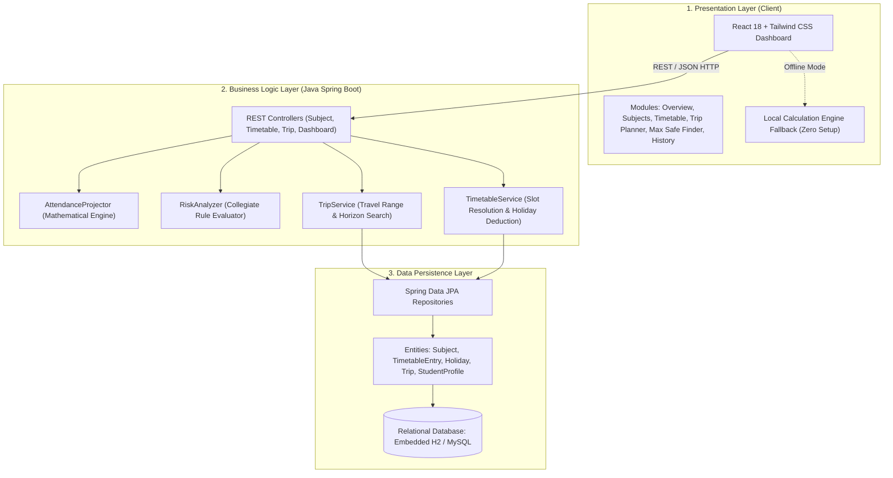
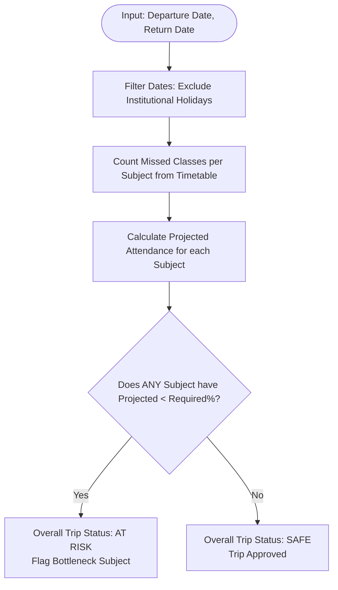
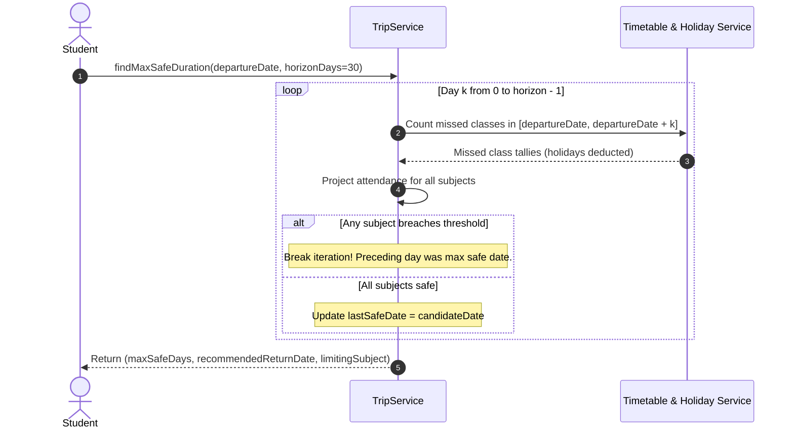
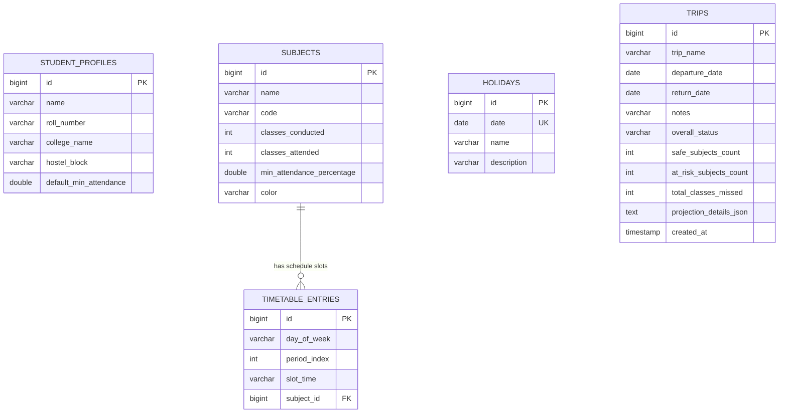

# PROJECT REPORT
## **TripSafe: A Pre-Travel Attendance Risk Projector for Hostel Students**

---

### **Academic Details**
* **Project Title:** TripSafe — Pre-Travel Attendance Risk Projector for Hostel Students  
* **Domain:** Full-Stack Web Development, Educational Technology, Decision Support Systems  
* **Architecture:** Three-Tier Architecture (Presentation, Business Logic, Data Persistence)  
* **Core Technologies:** Java 17, Spring Boot 3.2, Spring Data JPA, Hibernate, H2 / MySQL, React 18, TypeScript, Tailwind CSS  
* **Author / Candidate:** Student Project Submission  

---

## 1. ABSTRACT

In collegiate academic institutions, maintaining a mandatory minimum attendance percentage—typically 75%—is an uncompromising prerequisite for semester examination eligibility. Hostel students frequently encounter the dilemma of traveling home for weekends, regional festivals, or personal emergencies without knowing the exact mathematical impact on their subject-wise attendance. Because academic timetables are distributed unevenly across weekdays and because institutional holidays mitigate class cuts, manual attendance calculation is prone to severe errors, often resulting in sudden academic debarment.

**TripSafe** is an enterprise-grade, full-stack decision-support platform engineered to eliminate manual attendance guesswork. By modeling a student's weekly timetable, deducting registered institutional holidays, and evaluating inclusive travel date ranges, TripSafe projects subject-wise attendance down to individual lecture sessions. The system strictly enforces the **Multi-Subject Collegiate Rule**: a journey is marked **Safe** if and only if *every* individual course remains at or above its required threshold. Furthermore, the system introduces an automated **Maximum Safe Travel Window** optimization algorithm that calculates the longest consecutive travel duration a student can afford without risking examination eligibility.

---

## 2. INTRODUCTION & PROBLEM STATEMENT

### 2.1 Background
Hostel life requires students to balance campus obligations with family visits and personal commitments. In higher education universities:
1. Every enrolled course carries a distinct attendance tally (Conducted vs. Attended).
2. Weekly course frequency varies significantly (e.g., Data Structures meets 4 times a week, while Lab sessions meet once).
3. Travel dates frequently encompass institutional holidays or canceled classes that should not penalize attendance.
4. College debarment rules operate on a **per-subject threshold**, meaning that a high cumulative average attendance across all courses does not protect a student from being debarred in a single deficient subject.

### 2.2 The Problem
Traditional methods rely on rough student estimates, inaccurate diary counting, or naive averages:
* **The "High Average" Fallacy:** A student averaging 88% overall may erroneously assume a 4-day trip is safe, failing to realize that 3 missed lectures in a low-margin course will drop that specific course to 74%, resulting in immediate debarment.
* **Holiday Miscalculation:** Failing to account for college breaks results in overly restrictive travel plans, while assuming non-instructional days without checking institutional calendars causes attendance violations.
* **Manual Date Counting Friction:** Counting how many classes of Subject $X$ fall between Departure Day (e.g., Thursday 2 PM) and Return Day (e.g., Tuesday 10 AM) is tedious and error-prone.

### 2.3 Proposed Solution
**TripSafe** transforms manual calculations into an automated, verified, and interactive predictive system. It incorporates:
* Subject-by-subject attendance records with physical invariant constraints.
* A configurable weekly timetable grid (Monday through Sunday).
* An academic holiday exemption ledger.
* Instant pre-travel risk projection with explanation strings.
* An iterative search engine determining the maximum safe duration.

---

## 3. SYSTEM REQUIREMENTS SPECIFICATION (SRS)

### 3.1 Functional Requirements (FR)
1. **FR1 — Subject Management:** The system must allow users to create, read, update, and delete subjects with attributes: Name, Subject Code, Classes Conducted, Classes Attended, Minimum Required Percentage, and Badge Color.
2. **FR2 — Data Validation:** 
   * Classes attended cannot exceed classes conducted ($Attended \le Conducted$).
   * All class tallies must be non-negative integers ($Conducted \ge 0, Attended \ge 0$).
   * Zero conducted classes must resolve to $100.0\%$ safely without division-by-zero exceptions.
3. **FR3 — Weekly Timetable Modeling:** Users must be able to assign subjects to designated periods across weekdays.
4. **FR4 — Holiday Exemption:** Institutional holidays registered in the system must be excluded from missed-class counts during travel date intervals.
5. **FR5 — Travel Risk Projection:** The system must accept departure and return dates (inclusive), count scheduled classes per course, compute projected post-trip attendance, and classify each course as `SAFE` or `AT_RISK`.
6. **FR6 — Strict Collegiate Rule:** The overall trip status must be classified as `AT_RISK` if *any* single subject breaches the threshold.
7. **FR7 — Maximum Safe Travel Duration:** The system must compute the longest safe consecutive date window from a given departure date up to an adjustable horizon (default 30 days), identifying the bottleneck course.
8. **FR8 — Trip History Persistence:** Users must be able to save trip projection snapshots with freeze-frame JSON calculation states.

### 3.2 Non-Functional Requirements (NFR)
* **Performance:** Projection calculation must return in $< 50\text{ ms}$.
* **Usability:** Responsive layout supporting desktop and mobile browsers, color-coded status badges, and accessible controls.
* **Data Integrity:** Referential integrity with cascading deletes between subjects and timetable entries.
* **Maintainability:** Modular separation of presentation, business logic, and persistence layers.

---

## 4. SYSTEM ARCHITECTURE & HIGH-LEVEL DESIGN

TripSafe employs a strict **Three-Tier Architecture** ensuring high cohesion and low coupling:



### Layer Responsibilities

1. **Presentation Layer (Frontend):**
   * Built with React 18, TypeScript, Tailwind CSS, and Lucide Icons.
   * Delivers an intuitive dashboard with responsive progress bars, comparative threshold indicators, interactive timetable grids, and visual alert banners.
   * Includes an offline client-side calculation engine for instant zero-dependency demonstration.

2. **Business Logic Layer (Backend Services):**
   * Developed in Java 17 using Spring Boot 3.2.
   * Contains stateless pure domain services (`AttendanceProjector`, `RiskAnalyzer`) and transactional orchestrators (`TripService`, `TimetableService`).
   * Enforces input validation via Jakarta Validation (`@Valid`, `@NotNull`, `@Min`).

3. **Data Layer (Persistence):**
   * Implements Object-Relational Mapping (ORM) via Spring Data JPA and Hibernate.
   * Backed by a persistent embedded H2 file database for zero-configuration development, with production support for MySQL.

---

## 5. OBJECT-ORIENTED PROGRAMMING (OOP) IMPLEMENTATION

The backend demonstrates core Java Object-Oriented principles:

### 5.1 Encapsulation
All entity state variables are declared `private` and manipulated strictly through getters, setters, and domain validation methods.
```java
// Snippet from Subject.java
public class Subject {
    private Long id;
    private String name;
    private int classesConducted;
    private int classesAttended;
    private double minAttendancePercentage = 75.0;

    public static void validateAttendanceValues(int conducted, int attended) {
        if (conducted < 0 || attended < 0) {
            throw new IllegalArgumentException("Class counts cannot be negative.");
        }
        if (attended > conducted) {
            throw new IllegalArgumentException("Attended (" + attended + ") cannot exceed conducted (" + conducted + ").");
        }
    }

    public void setClassesConducted(int classesConducted) {
        validateAttendanceValues(classesConducted, this.classesAttended);
        this.classesConducted = classesConducted;
    }
}
```

### 5.2 Abstraction
Complex mathematical models and calendar traversal logic are abstracted behind high-level service interfaces. Presentation controllers never perform raw calculations:
```java
// Snippet from AttendanceProjector.java
@Component
public class AttendanceProjector {
    public double calculateCurrentPercentage(int attended, int conducted) {
        if (conducted <= 0) return 100.0;
        return ((double) attended / (double) conducted) * 100.0;
    }

    public double calculateProjectedPercentage(int attended, int conducted, int missed) {
        int total = conducted + missed;
        if (total <= 0) return 100.0;
        return ((double) attended / (double) total) * 100.0;
    }
}
```

### 5.3 Association & Cascading
Entities model real-world academic relationships:
* `TimetableEntry` maintains a `@ManyToOne` association with `Subject`.
* Cascading deletes are enforced: deleting a subject automatically clears corresponding timetable slots without leaving orphaned foreign keys.
* `Trip` entity encapsulates a freeze-frame serialized JSON snapshot of all subject projections at the moment of calculation, preserving auditability.

### 5.4 Separation of Concerns
* **DTO Pattern:** Data Transfer Objects (`TripRequest`, `TripProjectionResponse`, `SubjectDto`) isolate persistence entities from client-facing serialization.
* **Global Exception Handling:** `@RestControllerAdvice` traps validation failures and domain errors, converting them into uniform JSON responses.

---

## 6. MATHEMATICAL MODEL & ALGORITHMS

### 6.1 Attendance Formulas

#### Current Attendance:
$$\text{Current Attendance (\%)} = \begin{cases} 
100.0 & \text{if } C = 0 \\
\left(\frac{A}{C}\right) \times 100 & \text{if } C > 0 
\end{cases}$$
Where:
* $A = \text{Classes Attended}$
* $C = \text{Classes Conducted}$

#### Projected Attendance:
In collegiate attendance tracking, an absence during a trip increases total conducted sessions while attended sessions remain static:
$$\text{Projected Attendance (\%)} = \left(\frac{A}{C + M}\right) \times 100$$
Where:
* $M = \text{Expected Missed Classes during the trip interval}$

---

### 6.2 The Multi-Subject Collegiate Rule



$$\text{Trip Status} = \begin{cases} 
\text{SAFE} & \text{if } \forall s \in S: \text{Projected}_s \ge \text{Threshold}_s \\
\text{AT RISK} & \text{if } \exists s \in S: \text{Projected}_s < \text{Threshold}_s 
\end{cases}$$

---

### 6.3 "Find My Maximum Safe Trip" Horizon Search Algorithm



---

## 7. DATABASE DESIGN & DATA MODELING

The schema is normalized to **Third Normal Form (3NF)**:



### Table Integrity Constraints
1. **`subjects`:** `CHECK (classes_conducted >= 0 AND classes_attended >= 0 AND classes_attended <= classes_conducted)`
2. **`timetable_entries`:** `UNIQUE (day_of_week, period_index)` prevents conflicting assignments. Foreign key `subject_id` references `subjects(id)` with `ON DELETE CASCADE`.
3. **`holidays`:** `UNIQUE (date)` ensures no duplicate date entries.
4. **`trips`:** `CHECK (return_date >= departure_date)` enforces date ordering.

---

## 8. REST API SPECIFICATION

| Method | Endpoint | Description | Request Body / Parameters | Response Status |
|---|---|---|---|---|
| `GET` | `/api/dashboard` | Aggregated dashboard metrics & upcoming trip | None | `200 OK` |
| `GET` | `/api/subjects` | List all tracked subjects | None | `200 OK` |
| `POST` | `/api/subjects` | Create new subject with validation | `SubjectDto` | `201 Created` |
| `PUT` | `/api/subjects/{id}` | Update subject details and attendance counts | `SubjectDto` | `200 OK` |
| `DELETE`| `/api/subjects/{id}` | Delete subject (cascades timetable entries) | None | `204 No Content` |
| `GET` | `/api/timetable` | Retrieve weekly schedule entries | None | `200 OK` |
| `POST` | `/api/timetable/slot`| Assign or update subject to a period slot | `TimetableEntryDto` | `201 Created` |
| `DELETE`| `/api/timetable/slot/{id}` | Clear a timetable slot | None | `204 No Content` |
| `GET` | `/api/holidays` | List registered institutional holidays | None | `200 OK` |
| `POST` | `/api/holidays` | Register a new holiday / break | `HolidayDto` | `201 Created` |
| `DELETE`| `/api/holidays/{id}` | Remove a holiday entry | None | `204 No Content` |
| `POST` | `/api/trips/project` | Calculate projected attendance without saving | `TripRequest` | `200 OK` |
| `POST` | `/api/trips` | Calculate projection and save to history | `TripRequest` | `201 Created` |
| `POST` | `/api/trips/max-safe-duration` | Execute forward search for maximum safe trip | `MaxSafeDurationRequest` | `200 OK` |
| `GET` | `/api/trips` | Retrieve historical saved trips | None | `200 OK` |
| `DELETE`| `/api/trips/{id}` | Delete trip from history | None | `204 No Content` |
| `POST` | `/api/demo/load` | Seed verified college demonstration dataset | None | `200 OK` |
| `POST` | `/api/demo/reset` | Clear all data for fresh evaluation | None | `200 OK` |

---

## 9. VERIFICATION & TEST REPORT

Unit tests implemented in `backend/src/test/java/com/tripsafe/` verify calculation correctness:

### 9.1 Boundary Value Verification (Core Specification Test)
* **Given Subject:** Data Structures & Algorithms ($Attended = 60$, $Conducted = 75$, $Req = 75.0\%$)
* **Current Status:** $\frac{60}{75} \times 100 = 80.0\%$ (SAFE, $+5.0\%$ cushion).

| Test Case | Missed Classes ($M$) | Formula | Projected Pct | Status | Verdict |
|---|---|---|---|---|---|
| **Boundary Test 1** | $M = 5$ | $\frac{60}{75 + 5} \times 100 = \frac{60}{80} \times 100$ | **$75.0\%$** | **`SAFE`** | **PASSED** |
| **Boundary Test 2** | $M = 6$ | $\frac{60}{75 + 6} \times 100 = \frac{60}{81} \times 100$ | **$74.074\%$** | **`AT_RISK`** | **PASSED** |

> [!IMPORTANT]
> The transition between 5 missed classes ($75.0\%$) and 6 missed classes ($74.07\%$) precisely proves that the calculation engine detects threshold violations without rounding errors.

### 9.2 Collegiate Multi-Subject Policy Verification
* **Scenario:** Student enrolled in 5 subjects. 4 subjects maintain projected attendance between $90\%$ and $95\%$. 1 subject drops to $74.07\%$.
* **Aggregate Average:** $\frac{95 + 90 + 92 + 91 + 74.07}{5} = 88.41\%$
* **Evaluation:** Despite an $88.41\%$ average, `RiskAnalyzer.evaluateOverallTripStatus()` yields **`AT_RISK`**.
* **Verdict:** **PASSED** (Prevents false student confidence).

### 9.3 Invariant & Error Handling Tests
* Zero conducted sessions: yields $100.0\%$ without division-by-zero errors.
* Attended classes $> Conducted$: rejected with `IllegalArgumentException`.
* Negative class tallies: rejected with `IllegalArgumentException`.
* Trip departure date after return date: rejected with validation error.

---

## 10. APPLICATION MODULES & USER WORKFLOW

```
TripSafe Web Application
├── 1. Overview & Guide (Landing Page)
├── 2. Live Dashboard (Threshold Markers & Summary Cards)
├── 3. Subject Management (Add/Edit/Delete & Live Margin Preview)
├── 4. Timetable & Holiday Planner (Monday-Sunday Slots & Exemption Ledger)
├── 5. Core Trip Planner (Pre-Travel Attendance Risk Projector)
├── 6. Find My Maximum Safe Trip (Automated Horizon Optimizer)
├── 7. Trip History & Saved Snapshots (Historical Audit Log)
└── 8. Administration & Settings (Profile, Policy Cutoffs & Demo Reset)
```

1. **Dashboard:** Displays overall academic standing, average attendance, and an SVG progress bar with a dashed vertical line at $75\%$ to highlight safe vs. at-risk subjects.
2. **Subject Management:** Form with real-time percentage calculations and visual badge color picker.
3. **Weekly Timetable:** Period-by-period matrix. Click-to-assign modal maps courses to days. Dedicated holiday tab exempts non-instructional dates.
4. **Trip Planner (Core):** User selects dates; system outputs a table of missed classes, projected percentages, and risk margins.
5. **Max Safe Duration Finder:** Day-by-day forward calculation identifying the limiting bottleneck course.
6. **Trip History:** Stored records with freeze-frame JSON snapshots.
7. **Administration & Settings:** Profile customization, policy threshold adjustment, and demo reset controls.

---

## 11. CONCLUSION & FUTURE SCOPE

### 11.1 Conclusion
TripSafe solves a widespread practical problem for college hostel students. By integrating timetable schedules, holiday exemptions, and threshold constraints into a responsive web application, the project replaces manual guesswork with reliable travel risk predictions. The software demonstrates robust Java OOP design, 3NF database normalization, and a modern TypeScript user interface.

### 11.2 Future Enhancements
* **Biometric LMS Integration:** Automated synchronization with university ERP systems (e.g., Moodle, Blackboard) via OAuth2.
* **Smart Make-up Class Forecaster:** Recommending the exact number of future consecutive classes a student must attend to recover from an at-risk status.
* **Push Notifications:** Alerting students when university holiday schedules change or sudden class cancellations create new safe travel opportunities.
